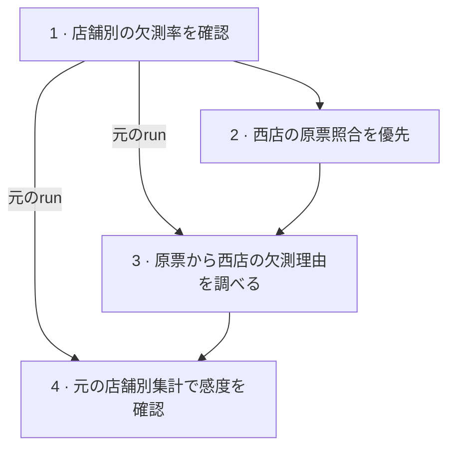

# 作業履歴

<!-- Generated by inquiry-lab history render. Edit the JSON source. -->

## 分析の依存関係

矢印は、参照した記録から、それを使った試行・判断へ向かう。

## 現在地

仮定への感度を確認した。実額を比較するには西店の原票が必要。

[該当する記録](#entry-4)

## 試行履歴

- **店舗別の欠測率を確認** — 西店の欠測率は20%で東店より高く、観測済みの客単価だけで比較するのは難しいと判断した。 [詳細](history/000001.md)

- **西店の原票照合を優先** — 欠測の理由を確認するため、西店の原票照合を優先することにした。 [詳細](history/000002.md)

- **原票から西店の欠測理由を調べる** — 原票を入手できず検証を中断。元の店舗別集計で感度を調べる方針に切り替えた。 [詳細](history/000003.md)

- **元の店舗別集計で感度を確認** — 欠測額の仮定は西店の平均に大きく影響したため、実額に基づく店舗比較は保留した。 [詳細](history/000004.md)
