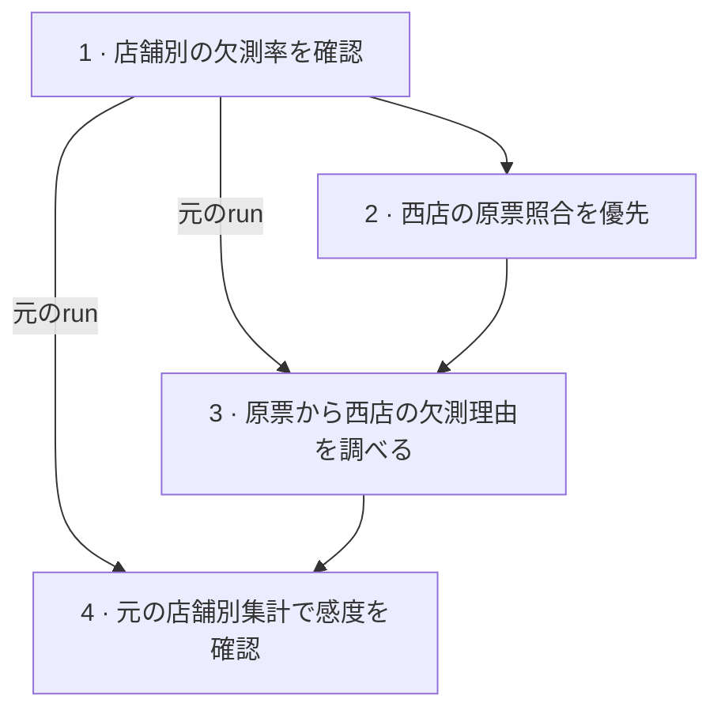

# 作業履歴

<!-- Generated by inquiry-lab history render. Edit the JSON source. -->

## 分析の依存関係

矢印は、参照した記録から、それを使った試行・判断へ向かう。

## 現在地

仮定への感度を確認した。実額を比較するには西店の原票が必要。

[該当する記録](#entry-4)

## 試行履歴

### run-001　店舗別の欠測率を確認

- **仮説**
  - 購入額が記録された取引だけで東西の客単価を比べてよいか判断したい。店舗によって欠測の割合が違う可能性がある。
- **検証**
  - 4月取引台帳v1を1取引1行として店舗別に集計した。
  - 購入額が空の件数を、各店舗の全取引件数で割った。
- **結果**
  - 東店の欠測は100件中2件（2%）。
  - 西店の欠測は80件中16件（20%）。
- **考察**
  - 西店では購入額が不明な取引が多く、観測済みの平均が全取引を代表するか判断できない。
- **参考**
  - [店舗別の欠測件数と取引件数（C-count行）](<observations.csv>)

この時点の現在地　東西の客単価の比較は保留。西店の原票を入手したら、欠測理由を確認する。

### 判断の記録　西店の原票照合を優先

依存元　[記録1](#entry-1)

- **判断**
  - 西店の4月分の原票を照合するまで、店舗間の客単価の比較を保留する。
- **理由**
  - 西店では購入額の欠測率が20%で、東店の2%より高かった。
- **参考**
  - [店舗別の欠測件数（C-count行）](<observations.csv>)

この時点の現在地　客単価の比較は保留。西店の原票と購入額の欠測した16件を照合できれば再開する。

### run-002　原票から西店の欠測理由を調べる

元のrun　[記録1](#entry-1)

依存元　[記録2](#entry-2)

- **仮説**
  - 西店の原票を確認すれば、欠測した購入額を特定できるかもしれない。
- **検証**
  - 西店の原票が今回の分析用データに含まれているか確認した。
- **結果**
  - 原票を入手できず、16件の購入額も欠測理由も確認できなかった。
- **考察**
  - 原票の照合を中断し、元の店舗別集計で欠測が平均に与える影響を調べる。
- **参考**
  - なし

この時点の現在地　原票待ち。入手済みの店舗別集計を使って感度を確認する。

### run-003　元の店舗別集計で感度を確認

元のrun　[記録1](#entry-1)

依存元　[記録3](#entry-3)

- **仮説**
  - 原票がなくても、欠測分の金額について置いた仮定が客単価に与える影響は計算できる。
- **検証**
  - run-001の店舗別件数に戻り、欠測1件あたりの仮定額を1,000円上げたときの店舗平均の変化を計算した。
- **結果**
  - 西店の平均は200円（1,000円 × 16/80）、東店の平均は20円（1,000円 × 2/100）上がる。
- **考察**
  - 同じ仮定の変化でも西店への影響が大きい。実際の欠測額は未確認なので店舗間の順位は保留する。
- **参考**
  - [感度計算に使った店舗別件数（C-count行）](<observations.csv>)
